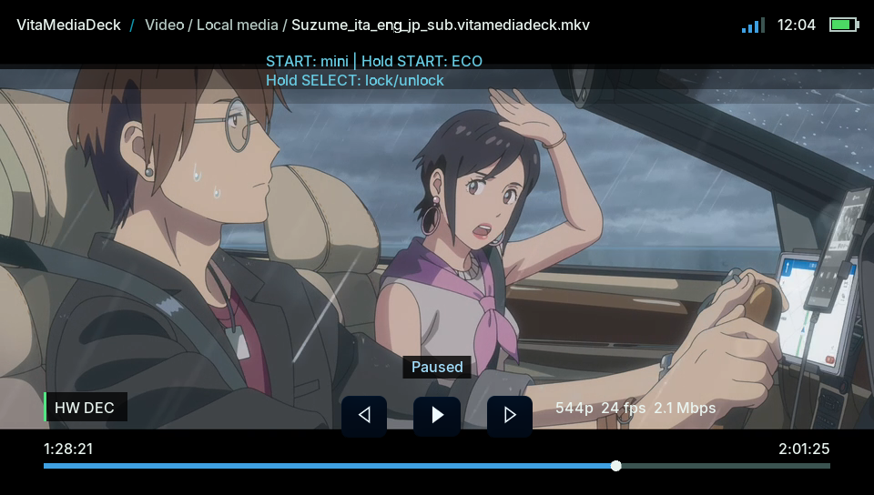
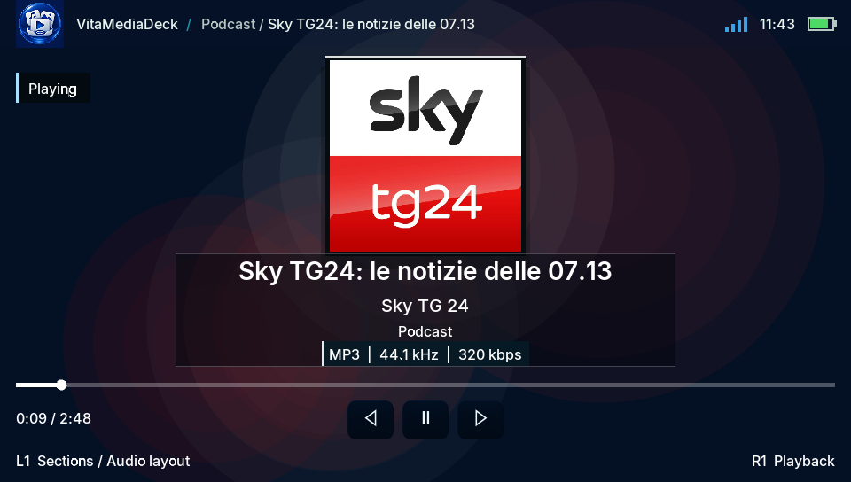
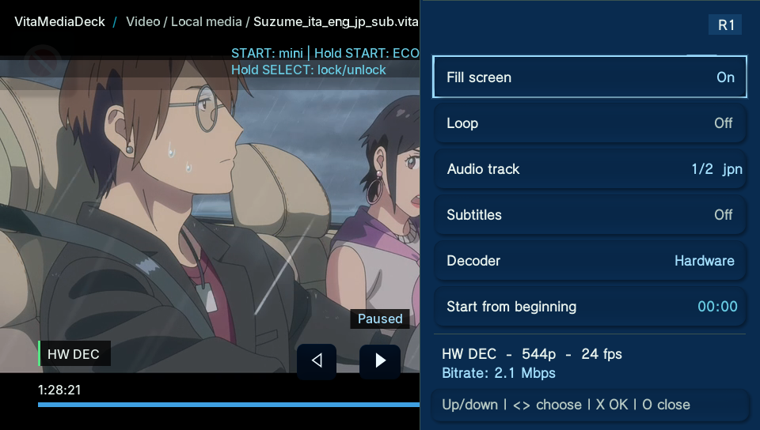
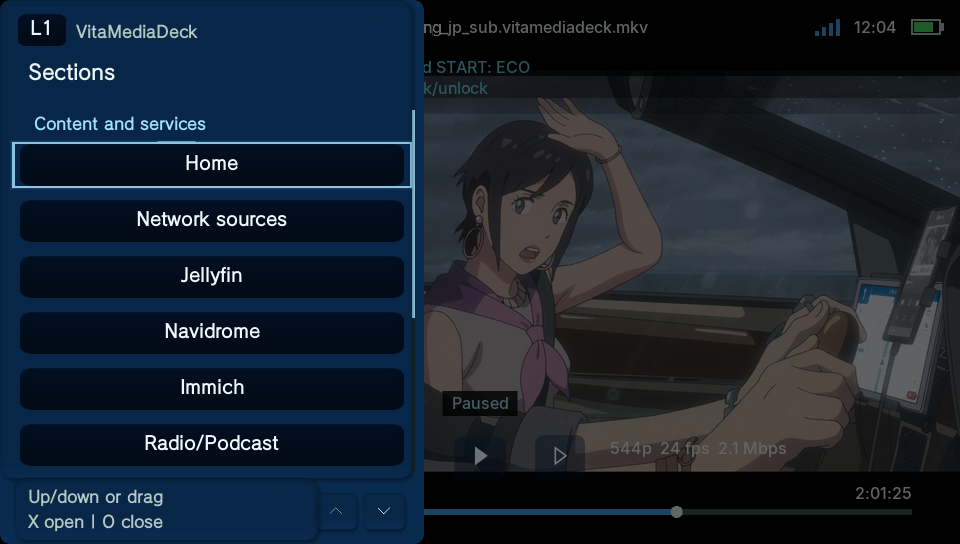

# VitaMediaDeck 1.4.1

  

  <strong>Your videos, music and photos, together on PlayStation Vita.</strong> 
  <a href="https://github.com/spyro-98/VitaMediaDeck/releases">Releases</a> ·
  <a href="docs/README.md">Documentation</a> ·
  <a href="https://github.com/spyro-98/VitaMediaDeck/issues">Report an issue</a>

VitaMediaDeck is a **public-beta media app for PS Vita**, combining local files,
personal media servers, internet radio, podcasts and IPTV. Version **1.4.1** brings
the native **VMD** interface, faster playback and seeking, new server integrations
and a more responsive library.

  
   The new Home, with VMD as the default theme

## Features

- **Video playback:** H.264/AVC in MP4, M4V, MOV and MKV, mono/stereo AAC,
  multiple audio tracks, text subtitles, seeking and saved playback positions.
- **Music:** MP3, AAC, M4A, WAV and FLAC, with artwork, metadata, shuffle,
  repeat, a full-screen player and a persistent mini-player.
- **Photos:** local image libraries and Immich albums, with cached previews,
  zoom, pan and 90-degree rotation. JPEG, PNG, WebP and other supported formats.
- **Personal media servers:** Jellyfin video libraries, **Navidrome music**
  and **Immich photos**, with saved connections and dedicated provider sections.
- **Network files and downloads:** WebDAV, SFTP and SMB browsing, direct HTTP(S)
  downloads, QR links, destination selection and background transfers.
- **Radio, podcasts and IPTV:** regional discovery, artwork, favourites,
  podcast streaming/downloads and compatible HLS/DASH streams or M3U channel lists.
- **A connected library:** one Home for unfinished media, saved connections,
  favourites and recently played items, plus background search across indexed
  titles, filenames, artists, albums and available provider metadata.

## Improvements in 1.4.1

### Native interface and eight themes

**VMD is the new default theme**, using actual Sony PAF text, buttons, toggles
and loading indicators. Its dark animated background combines thin cyan light
trails with a subtle moving PlayStation-symbol pattern.

- **Eight themes:** VMD, Legacy, Ghost Mesh, Deck 90, Signal, Aperture, Relay
  and Mosaic. The alternatives have distinct layouts, lighting and animations.
- Smoother folder/page transitions, menu movement and focus effects, with fewer
  repeated entrance animations during rapid navigation.
- Consistent styling across players, settings, dialogs, downloads and QR scanning.
- Integrated Home components, clearer provider lists, touch scrolling and
  independently saved tab order for each theme.

### Faster playback and seeking

**Hardware decoding is the recommended first choice.** The default Auto mode
tries HW first for compatible video, keeping CPU load lower and leaving more
headroom for the interface and streaming.

- Faster video startup, playback-control response, indexed seeking and recovery
  of picture and sound after a seek.
- More efficient HW frame presentation, fewer unnecessary allocations/copies,
  improved worker scheduling and cleaner cancellation/shutdown.
- Improved SW YUV copying, padding and frame queues, reducing CPU-side overhead.
- **333 MHz CPU for tested HW playback, including compatible 720p30 video**;
  the automatic SW target is **444 MHz**. Both targets are configurable, and
  manual PSVshell clock settings retain priority.
- Complete app-owned LTO coverage across the app, decoder, HTTPS and IPTV
  modules, alongside FFmpeg C LTO, Cortex-A9/NEON optimization and unused-code
  removal at link time.

### Browsing, streaming and resume

- Cached catalogue data and artwork appear before background refreshes, reducing
  loading interruptions between radio, podcasts and other media sections.
- Global search runs in background workers and shows cached/progressive results
  grouped by provider, without reopening every file to read its tags.
- More reliable podcast resume after closing or suspending the app, with
  lightweight playback checkpoints saved in the background.
- Add/remove favourites with inline stars, including favourite countries for
  regional radio and podcast discovery.
- Improved IPTV loading feedback, decoder selection and hardware playback,
  with corrected HLS timestamps and hardware-codec initialization/cleanup.

## Bug fixes

- QR/IPTV link validation, full broadcaster User-Agent headers and clearer
  playlist, server, codec and resolution errors, with readable multiline notices.
- MP4 files missing their total duration or refusing to seek.
- Subtitles disappearing after seeking and unreliable audio-track recovery.
- Missing thumbnails after returning from playback and lost browser position.
- Clipped text, selection borders and button labels across the native interface.
- Flickering player timing/volume labels, delayed HUD text and repeated menu
  entrance animations.
- Search-result selection, invisible search text and tab focus skipping items.
- Home collections opening their first item before allowing item selection.
- Local photos disappearing from Images when the index is empty or refreshing.
- Unbounded image panning, unpredictable rotation and incorrect ECO-mode text.
- Native PAF startup, rendering, widget lifecycle and recovery issues.

## Screenshots — 1.4.1

Select an image to view it at its original resolution.

<table>
  <tr>
    <td width="50%" align="center"> Local video library</td>
    <td width="50%" align="center"> Video player</td>
  </tr>
  <tr>
    <td width="50%" align="center"> Music player</td>
    <td width="50%" align="center"> Podcast player</td>
  </tr>
</table>

<strong>Other themes: Ghost Mesh, Deck 90, Signal, Aperture, Relay and Mosaic</strong>

<table>
  <tr>
    <td width="50%" align="center"> Ghost Mesh</td>
    <td width="50%" align="center"> Deck 90</td>
  </tr>
  <tr>
    <td width="50%" align="center"> Signal</td>
    <td width="50%" align="center"> Aperture</td>
  </tr>
  <tr>
    <td width="50%" align="center"> Relay</td>
    <td width="50%" align="center"> Mosaic</td>
  </tr>
</table>

<strong>Radio, provider menus and mini-players</strong>

<table>
  <tr>
    <td width="50%" align="center"> Live radio</td>
    <td width="50%" align="center"> Playback options</td>
  </tr>
  <tr>
    <td width="50%" align="center"> Sections and personal-media providers</td>
    <td width="50%" align="center"> Home with the audio mini-player</td>
  </tr>
  <tr>
    <td colspan="2" align="center"> Home with the live video mini-player</td>
  </tr>
</table>

## Compatibility

- Video requires compatible **H.264/AVC and mono/stereo AAC**. Jellyfin uses
  direct play; server transcoding is not integrated. PGS/VobSub bitmap subtitles
  are not rendered.
- IPTV supports compatible, non-DRM HLS/DASH streams. Automatic rendition
  selection is capped at **720p**; seeking in segmented HLS/DASH is not available.
- SW decoding remains more demanding: 720p30 can exceed the CPU budget,
  particularly at 333 MHz. HW remains the preferred backend.

[VitaMediaDeck Transcoder](https://github.com/spyro-98/VitaMediaDeck-Transcoder)
for macOS, Windows and Linux prepares Vita-oriented H.264/AAC files. Suitable
conversions can also play smoothly through SW decoding; HW is still recommended.

## Project family

| Project | Purpose |
| --- | --- |
| [vita-hw-decoder](https://github.com/spyro-98/vita-hw-decoder) | Hardware H.264/AAC decoding and direct NV12 presentation |
| [vita-sw-decoder](https://github.com/spyro-98/vita-sw-decoder) | Compatible software H.264 decoding fallback |
| [vita-https](https://github.com/spyro-98/vita-https) | Verified HTTPS and seekable network transport |
| [VitaMediaDeck Transcoder](https://github.com/spyro-98/VitaMediaDeck-Transcoder) | Optional desktop media preparation tool |

## Documentation

[Full documentation](docs/README.md) · [Controls guide](mds/CONTROLS.md) ·
[Build setup](mds/setup/TOOLCHAIN_SETUP.md) · [Validation](docs/VALIDATION.md) ·
[Contributing](CONTRIBUTING.md)

## License

VitaMediaDeck is licensed under **GPL-3.0-only**. See [LICENSE](LICENSE) and
[third-party notices](THIRD_PARTY_NOTICES.md).

VitaMediaDeck is an independent homebrew project. PlayStation, PS Vita, Sony
and their related marks belong to their respective owners.
