# VitaMediaDeck 1.4.3

  

  <strong>Your videos, music and photos, together on PlayStation Vita.</strong> 
  <a href="https://github.com/spyro-98/VitaMediaDeck/releases">Releases</a> ·
  <a href="docs/README.md">Documentation</a> ·
  <a href="https://github.com/spyro-98/VitaMediaDeck/issues">Report an issue</a>

VitaMediaDeck is a **public-beta media app for PS Vita**, combining local files,
personal media servers, internet radio, podcasts and IPTV. Version **1.4.3**
opens Home from saved local data while network setup and artwork discovery
continue independently in the background.

  <a href="screenshots/1.4.1/vmd-home.png">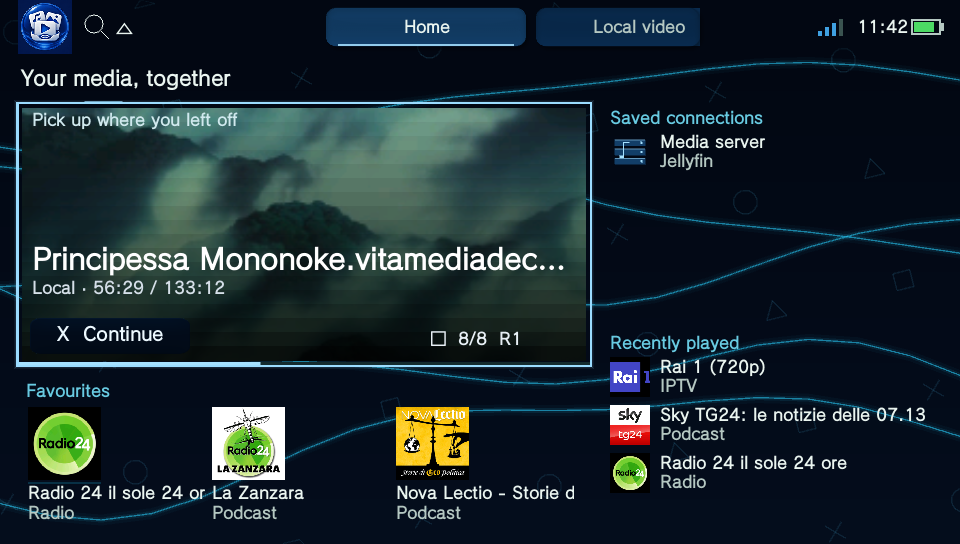</a>
   Home with the default VMD theme (1.4.1 screenshot)

## Features

- **Video playback:** H.264/AVC in MP4, M4V, MOV and MKV, mono/stereo AAC,
  multiple audio tracks, text subtitles, seeking and saved playback positions.
- **Music:** MP3, AAC, M4A, WAV and FLAC, with artwork, metadata, shuffle,
  repeat, a full-screen player and a persistent mini-player.
- **Photos:** local image libraries and Immich albums, with cached previews,
  zoom, pan and 90-degree rotation. JPEG, PNG, WebP and other supported formats.
- **Personal media servers:** Jellyfin video libraries, **Navidrome music**
  and **Immich photos**, with saved connections and dedicated provider sections.
- **Network files and downloads:** WebDAV, SFTP and SMB browsing, direct HTTP(S)
  downloads, QR links, destination selection and background transfers.
- **Radio, podcasts and IPTV:** regional discovery, artwork, favourites,
  podcast streaming/downloads and compatible HLS/DASH streams or M3U channel lists.
- **A connected library:** one Home for unfinished media, saved connections,
  favourites and recently played items, plus background search across indexed
  titles, filenames, artists, albums and available provider metadata.

## What's new in 1.4.3

- **Faster startup:** Home no longer waits for artwork discovery or network setup
  before showing saved local data. Background results update the existing UI.
- **Quicker cached artwork:** direct cache references restore images without
  waiting for a full directory scan or downloading them again.
- **Clearer connection status:** Wi-Fi bars stay visible in grey before setup or
  while offline, separate from the activity indicator.

<strong>Previous update — 1.4.2</strong>

- **Refined Vita interface:** blue VMD gradients and native PAF focus, clearer text,
  coloured button icons and organized L1/R1 menus. Continuous pixel scrolling,
  touch dragging and inertia across all eight themes.
- **Flexible IPTV imports:** add links, scan QR codes or choose local files from
  `ux0:` / `uma0:`. M3U/M3U8, TXT, PLS, XSPF, ASX and URL files can contain
  channels and nested playlist links; actual content determines their type.
  Channel names and icons are recovered when available, with cached artwork.
- **Clearer channel browsing:** separate or side-by-side playlist/channel views,
  multi-column channel grids, name sorting and Save/Remove actions in player R1.
  Saved channels and favourite stars remain separate.
- **Playback choices that stay saved:** per-channel quality and audio language,
  fallback when unavailable, and rollback after a failed quality change.
  Smoothness checks run only from R1; Triangle toggles mute in the players.
- **Background TV guide:** current programme, description, end time and upcoming
  schedule load without covering the video, when guide data is available.
- **More responsive browsing:** persistent channel/radio/podcast artwork,
  background refresh and Home collections that update after playback or edits.
- **More options and better recovery:** restored interface languages, radio
  1×3 / 2×3 layouts, 20 MiB channel lists, more robust HLS handling, clearer
  playback errors and retained session logs.

[Detailed changes and validation](docs/README.md).

## Screenshots

New captures are from **1.4.2**; earlier screenshots remain where no replacement is available. Select an image for full resolution.

<table>
  <tr>
    <td width="50%" align="center"><a href="screenshots/1.4.1/vmd-local-video.png">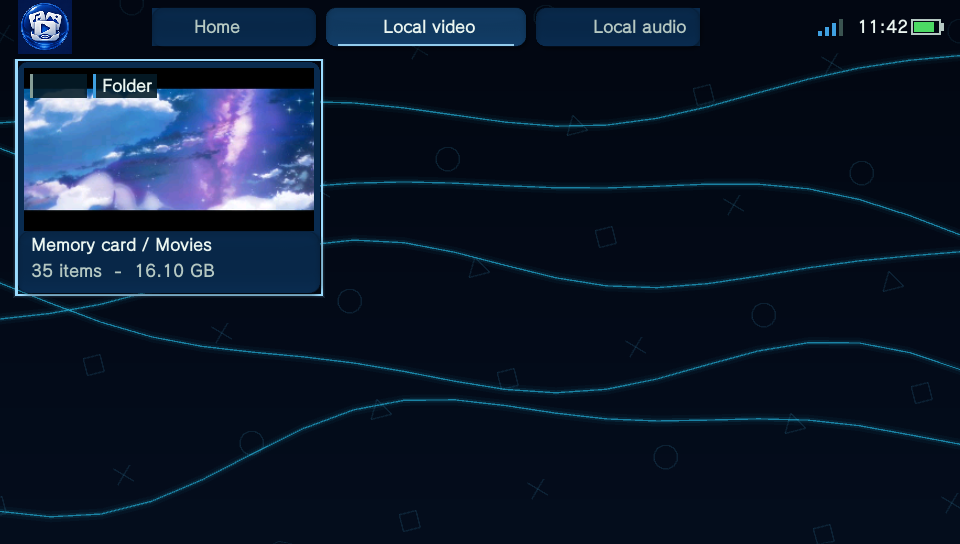</a> Local video library</td>
    <td width="50%" align="center"><a href="screenshots/1.4.2/vmd-video-player.png">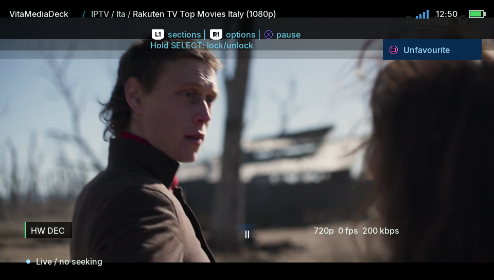</a> Live IPTV playback</td>
  </tr>
  <tr>
    <td width="50%" align="center"><a href="screenshots/1.4.1/vmd-music-player.png">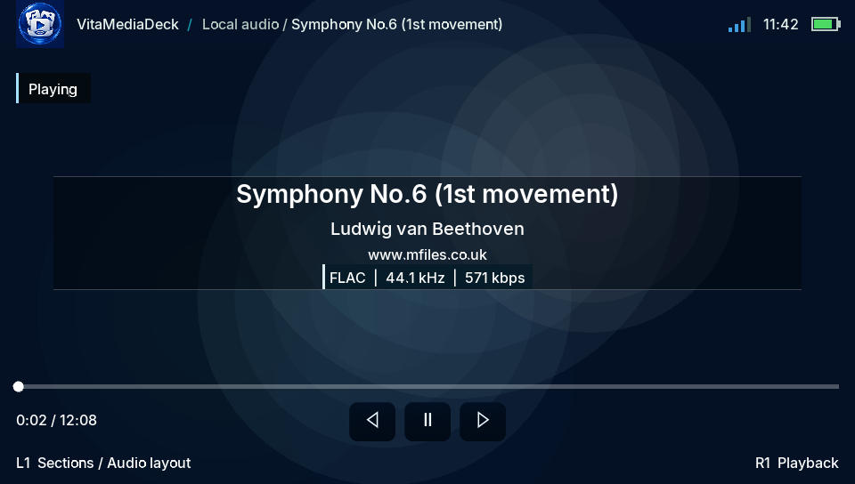</a> Music player</td>
    <td width="50%" align="center"><a href="screenshots/1.4.2/vmd-podcast-player.png">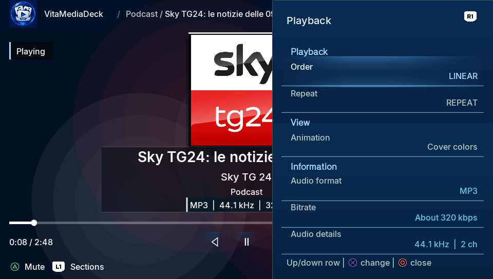</a> Podcast player and R1 options</td>
  </tr>
</table>

<strong>IPTV: channel views and programme guide — 1.4.2</strong>

<table>
  <tr>
    <td width="50%" align="center"><a href="screenshots/1.4.2/vmd-iptv-channels.png">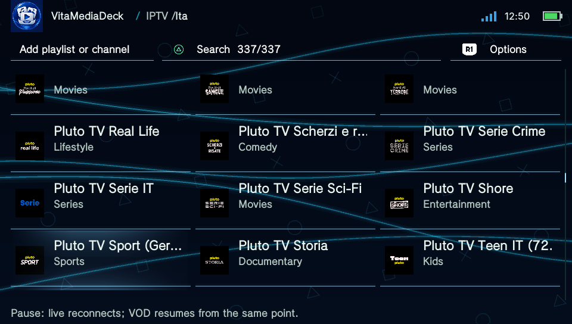</a> Full-width channel list</td>
    <td width="50%" align="center"><a href="screenshots/1.4.2/vmd-iptv-split-view.png">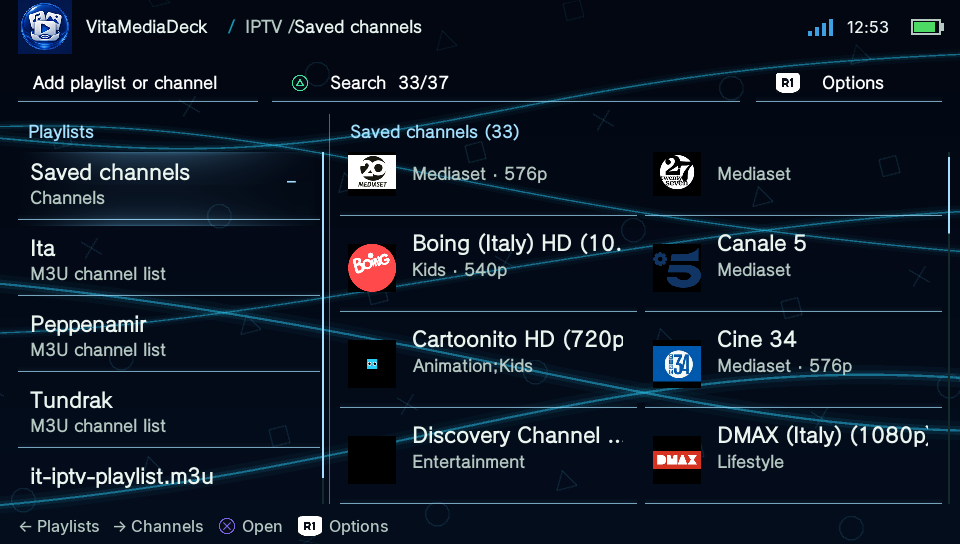</a> Playlists and channels side by side</td>
  </tr>
  <tr>
    <td colspan="2" align="center"><a href="screenshots/1.4.2/vmd-iptv-programme-guide.png">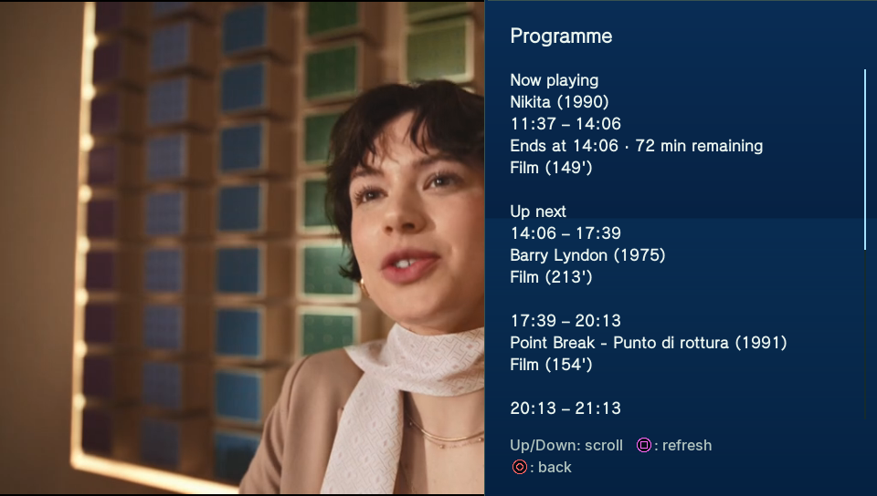</a> Current programme and upcoming schedule</td>
  </tr>
</table>

<strong>Other themes: Ghost Mesh, Deck 90, Signal, Aperture, Relay and Mosaic</strong>

<table>
  <tr>
    <td width="50%" align="center"><a href="screenshots/1.4.1/ghost-mesh.png">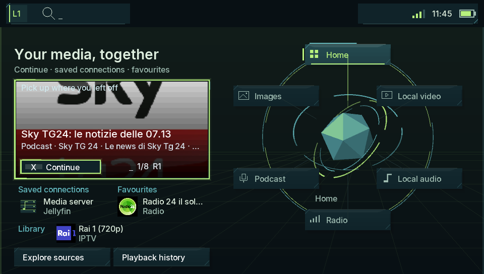</a> Ghost Mesh</td>
    <td width="50%" align="center"><a href="screenshots/1.4.1/deck-90.png">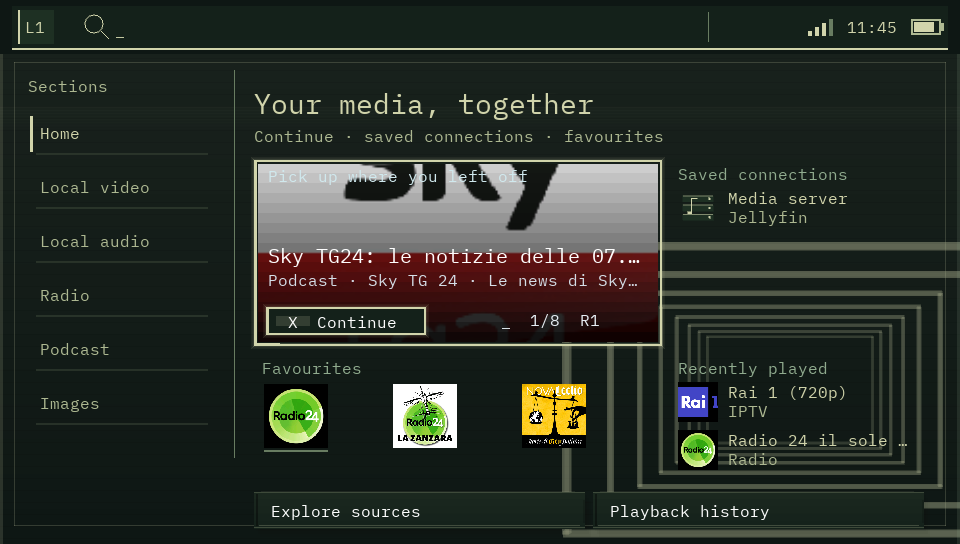</a> Deck 90</td>
  </tr>
  <tr>
    <td width="50%" align="center"><a href="screenshots/1.4.1/signal.png">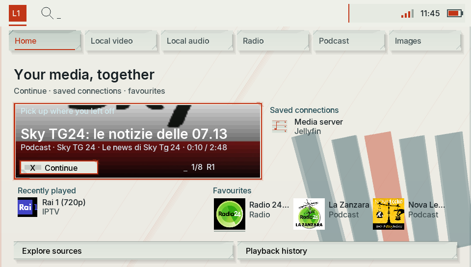</a> Signal</td>
    <td width="50%" align="center"><a href="screenshots/1.4.1/aperture.png">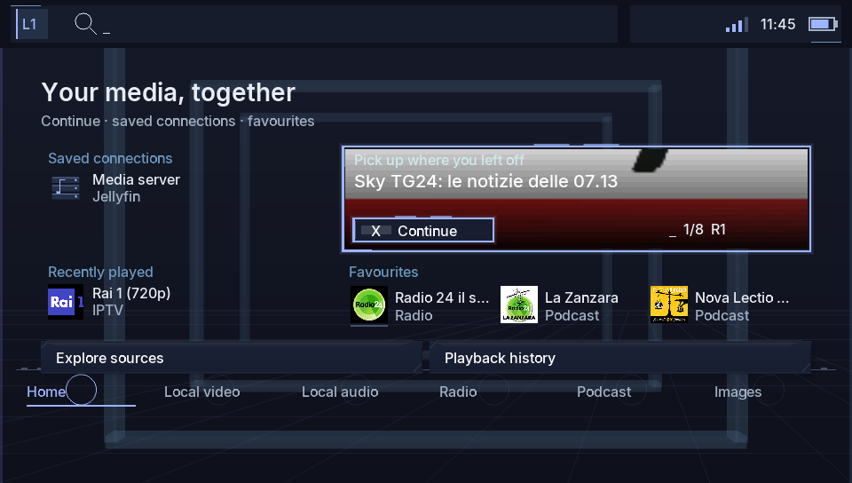</a> Aperture</td>
  </tr>
  <tr>
    <td width="50%" align="center"><a href="screenshots/1.4.1/relay.png">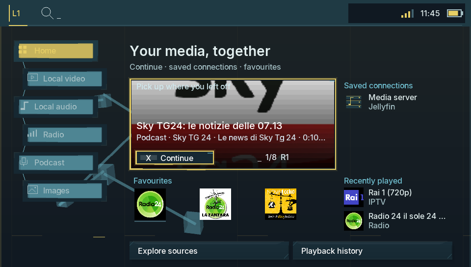</a> Relay</td>
    <td width="50%" align="center"><a href="screenshots/1.4.1/mosaic.png">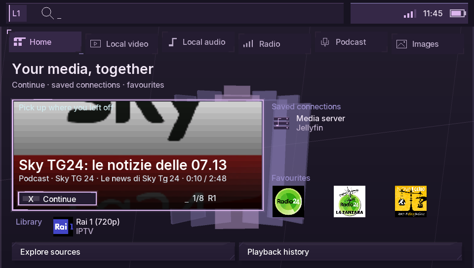</a> Mosaic</td>
  </tr>
</table>

<strong>Radio, provider menus and mini-players</strong>

<table>
  <tr>
    <td width="50%" align="center"><a href="screenshots/1.4.1/vmd-radio-player.png">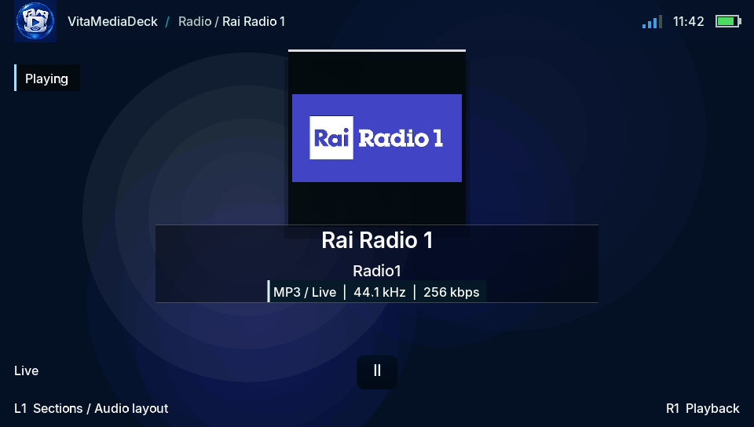</a> Live radio</td>
    <td width="50%" align="center"><a href="screenshots/1.4.2/vmd-playback-menu.png">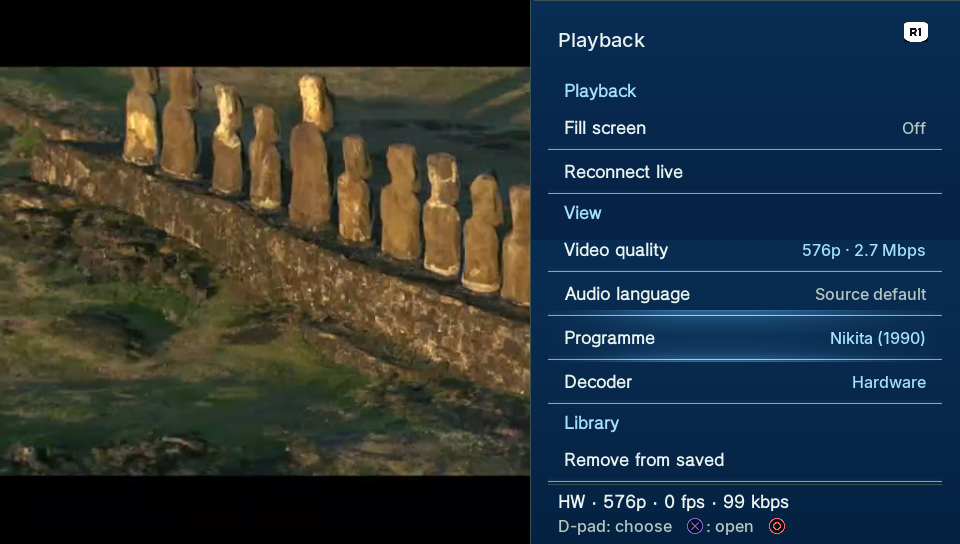</a> Quality, audio and saved-channel controls</td>
  </tr>
  <tr>
    <td width="50%" align="center"><a href="screenshots/1.4.2/vmd-sections-menu.png">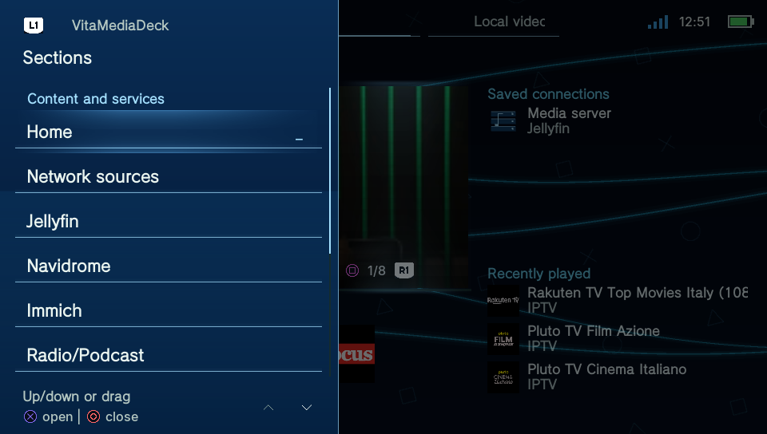</a> L1 sections menu</td>
    <td width="50%" align="center"><a href="screenshots/1.4.1/vmd-audio-miniplayer.png">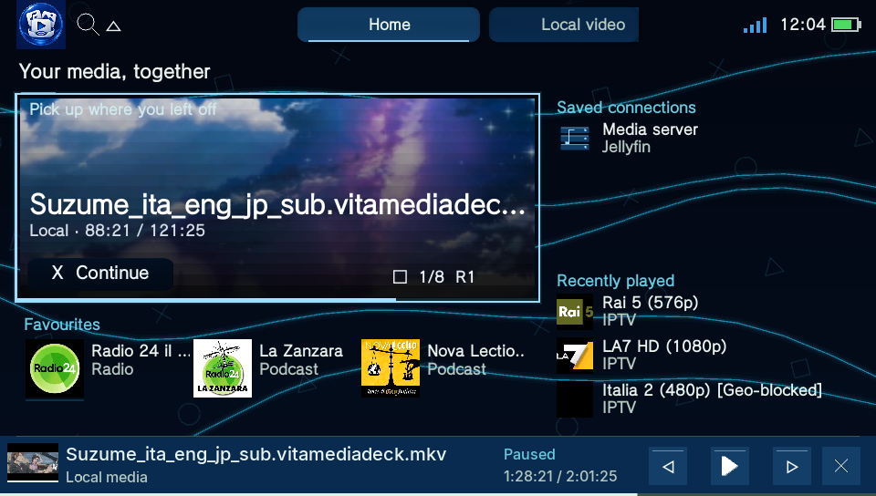</a> Home with the audio mini-player</td>
  </tr>
  <tr>
    <td colspan="2" align="center"><a href="screenshots/1.4.1/vmd-video-miniplayer.png">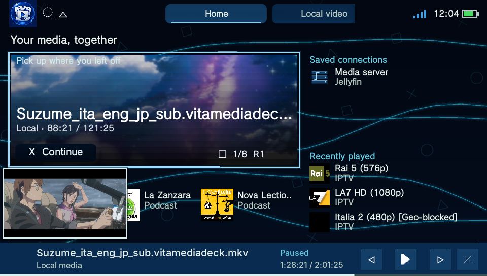</a> Home with the live video mini-player</td>
  </tr>
</table>

## Compatibility

- Video requires compatible **H.264/AVC and mono/stereo AAC**. Jellyfin uses
  direct play; server transcoding is not integrated. PGS/VobSub bitmap subtitles
  are not rendered.
- IPTV supports compatible, non-DRM HLS/DASH streams. Automatic rendition
  selection prefers lighter variants when available, with user-selectable quality
  and audio in R1. There is no automatic 720p/4-Mbps rejection. Seeking in
  segmented HLS/DASH is not available.
- SW decoding remains more demanding: 720p30 can exceed the CPU budget,
  particularly at 333 MHz. HW remains the preferred backend.

[VitaMediaDeck Transcoder](https://github.com/spyro-98/VitaMediaDeck-Transcoder)
for macOS, Windows and Linux prepares Vita-oriented H.264/AAC files. Suitable
conversions can also play smoothly through SW decoding; HW is still recommended.

## Project family

| Project | Purpose |
| --- | --- |
| [vita-hw-decoder](https://github.com/spyro-98/vita-hw-decoder) | Hardware H.264/AAC decoding and direct NV12 presentation |
| [vita-sw-decoder](https://github.com/spyro-98/vita-sw-decoder) | Compatible software H.264 decoding fallback |
| [vita-https](https://github.com/spyro-98/vita-https) | Verified HTTPS and seekable network transport |
| [VitaMediaDeck Transcoder](https://github.com/spyro-98/VitaMediaDeck-Transcoder) | Optional desktop media preparation tool |

## Documentation

[Full documentation](docs/README.md) · [Controls guide](mds/CONTROLS.md) ·
[Build setup](mds/setup/TOOLCHAIN_SETUP.md) · [Validation](docs/VALIDATION.md) ·
[Contributing](CONTRIBUTING.md)

## License

VitaMediaDeck is licensed under **GPL-3.0-only**. See [LICENSE](LICENSE) and
[third-party notices](THIRD_PARTY_NOTICES.md).

VitaMediaDeck is an independent homebrew project. PlayStation, PS Vita, Sony
and their related marks belong to their respective owners.
