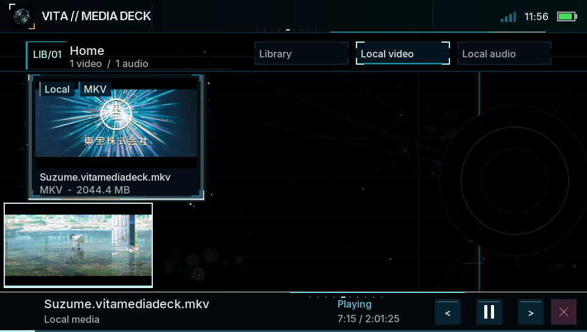
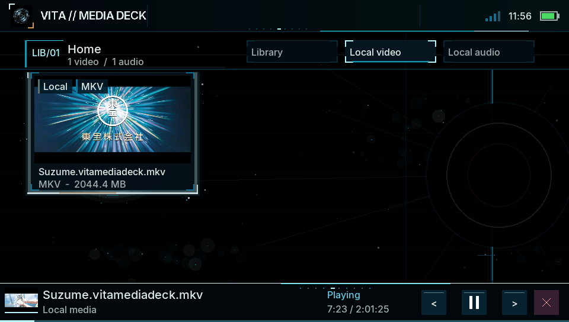

# VitaMediaDeck

[](LICENSE)

<p align="center">
  
</p>

<p align="center">
  <strong>A native local and authenticated-network media player for PlayStation Vita.</strong>
</p>

> [!IMPORTANT]
> **Public beta** — VitaMediaDeck is available publicly but remains in active
> development. Validate playback and network sources on your own PlayStation
> Vita before relying on it day to day.

VitaMediaDeck plays video and music stored on the Vita and video from Jellyfin
or authenticated WebDAV, SFTP, and SMB servers. Browsing, demuxing, decoding,
synchronization, and rendering run directly on the console.

**Home** is now one integrated dashboard: unfinished media takes priority,
saved connections open directly, and favourites, recent activity and access to
sources/history stay visible together. Components use different sizes and
presentations in each theme. D-pad/left stick moves between them; **R1/Square**
cycles items within a component, and **Triangle** opens global search. Full
collections are deliberate drill-downs rather than interchangeable Home lists.

Search matches indexed titles, filenames, artists and albums, with worker-prepared
results, cache and progressive loading. L1 scrolls only in the vertical Legacy, Legacy Vita,
Deck 90 and Aperture menus; the other wheels/grids remain fixed and use spatial
navigation. LTO now covers all app-owned decoder/HTTPS/IPTV targets as well as the
application and the existing FFmpeg C objects, with compiler-matched archive tools.
See the [dashboard/LTO report](docs/home-dashboard-lto-2026-10-24.md) for checks and
remaining console acceptance. Everything is in the standard **1.4.1** release VPK,
bubble **VitaMediaDeck**, log `session_standard.txt`.

Jellyfin is a dedicated **L1 → Jellyfin** provider immediately before Navidrome
in every theme. It reuses your saved Jellyfin servers, authentication and video
player; no duplicate setup is needed. Its server list offers the same R1
Connect/Add/Edit/Remove options as the other personal-media providers. See
[Jellyfin provider navigation](docs/jellyfin-provider-2026-10-24.md).

Navidrome music and Immich photos are available as dedicated **L1** sections
in all eight themes, and as Home entries in Library, Audio and Images. Add each
server from its section; use Navidrome credentials or an Immich API key. See
[configuration, supported media and Vita tests](docs/personal-media-2026-10-23.md).
The six newer themes include native animated lighting and material effects;
Legacy groups L1 into active tasks, content/services and application tools.
Vertical L1 menus scroll with animated focus following, larger targets,
touch dragging and fixed headers/footers. The wheel, grids and individual theme
layouts remain distinct. See [scrollable L1 navigation](docs/l1-scroll-2026-10-24.md).
See [native UI changes and validation limits](docs/game-ui-2026-10-23.md) and
[cached navigation, compact covers and the Ghost 3D scene](docs/cache-and-ghost-2026-10-23.md).
The [latest interface revision](docs/theme-chrome-2026-10-23.md) adds GPU MSAA 2x,
per-theme status chrome and command decks, more Legacy group spacing, and
independently saved Home tab positions for each theme.

The [continuous page-motion revision](docs/theme-motion-2026-10-23.md) adds
coherent list transitions, persistent menu focus and effects specific to each
of the eight themes. This work and the
[utility-screen theme coverage](docs/theme-coverage-2026-10-23.md) are integrated
in standard 1.4.1. Console animation/performance acceptance remains distinct
from host rendering checks.

## Current version: 1.4.1

Standard build: **VitaMediaDeck**, Vita `APP_VER` **01.05**, title ID
`VMDK00001`. Includes the updated eight themes, personal-media services,
cached browsing, decoder improvements and the MP4/subtitle seek fixes. This
patch integrates continuous list/menu motion, theme-specific focus effects,
QR/editor/loading coverage, badge contrast and cached destination enumeration.
See [1.4.1 release notes and validation](docs/releases/1.4.1.md),
[documentation index](docs/README.md) and [validation guide](docs/VALIDATION.md).
The local package is separate from publication of a GitHub release.

The integrated development baseline adds live MP3 radio, public podcast
discovery/streaming/downloads, favourites-only Radio/Podcast Home tabs,
regional catalogues, artwork and available radio programme metadata. It also
includes background-download UI, file/image/player improvements and navigation
fixes developed after 1.2. This is not a claim that a new GitHub release has
been published or that every provider has passed hardware testing.

The [provider-navigation follow-up](docs/provider-navigation-2026-10-24.md) adds
explicit Add/Remove favourite actions for radio and podcasts, including Home;
retains nested catalogue Back history; separates provider tabs from Home inputs;
clarifies IPTV saved/favourite actions; and gives Navidrome/Immich a consistent
R1 Options menu for managing local connections. These controls apply to all eight
themes. Favourite removal preserves downloaded files and remote content.

Press **L1** or tap the app logo to open sections. Use **Network** for media
servers, direct links and QR downloads, and **Radio/Podcast** to discover and
save stations/shows. Radio Home shows favourites. The single **Podcast** tab
has an Online favourites column and an Offline folder-navigation column.

Podcast resume points now use an independent low-priority saver: a 56-byte
checkpoint roughly every 15 seconds, with pause/suspend requests and recovery
from incomplete writes. Playback/render loops do not perform checkpoint I/O.
See [podcast resume changes and Vita checks](docs/podcast-resume-2026-10-24.md).

See [online audio and navigation](docs/online-audio-preview.md) for supported
formats, controls, limits and validation status.
See the [22 October quality review and Vita checklist](docs/quality-audit-2026-10-22.md)
for that historical host-check snapshot. The current
[validation guide](docs/VALIDATION.md) separates release checks from remaining
console acceptance tests.
Subsequent console-feedback fixes and four targeted Vita checks are documented
in [Home, thumbnails, image controls and seek](docs/ui-feedback-2026-10-22.md).
The [visual research and grid correction](docs/ui-style-research-2026-10-22.md)
compares new interface directions and records the equal-row layout checks.
Eight [themes and shared navigation](docs/themes-navigation-2026-10-23.md) are available in Settings → Interface → Theme:
Legacy (the default), Ghost Mesh, Deck 90, Signal, Aperture, Relay, Mosaic and **Legacy Vita**.
Legacy Vita keeps Legacy navigation and uses actual Sony PAF text, buttons,
panels and busy indicators throughout the app, including the player HUD, QR,
guide, dialogs and less-used screens. Media textures keep their existing GPU
path. This native integration requires console acceptance; hold L1+R1 while
starting the app to recover to Legacy. See the [PAF report](docs/legacy-vita-paf-2026-10-25.md).
Ghost Mesh uses the right stick for its wheel and the left stick/D-pad for content;
non-Legacy themes retain their own shell in radio, podcasts and discovery.

On `feature/iptv`, **L1 → IPTV** opens your saved lists and channels.
Choose **Start / Add stream** to enter an HTTP(S) HLS, DASH (`.mpd`) or M3U
channel-list URL. **R1 → Options** contains QR scanning and saving;
on saved entries, **R1 → Rename** changes the title without losing favourites.
Select **Play stream** or **Open channel list** to open
the link. **Select / Save link** registers a named list or stream. Select
saved entries; Square toggles a favourite, Triangle searches and R1 offers All/Starred. In an
opened list, Square stars a channel and Select stars the list. Saved URLs may
contain access tokens: `ux0:data/VitaMediaDeck/iptv-saved.json` is local storage,
not encrypted credential storage; do not share it.

During IPTV playback, **Square** or the HUD **Favourite** button stars/unstars
the current channel. In channel lists, **Filter errors** (also in R1 Options)
checks URLs without decoding playback and temporarily hides DNS/403/404
failures. Circle cancels; **Show all** restores everything. Unknown/time-out
results remain visible. See [availability checks and crash investigation](docs/iptv-availability.md)
for limitations and hardware retest notes.

HLS now uses FFmpeg's demuxer over the app's verified HTTP transport: MPEG-TS,
fragmented MP4 initialization maps, byte-range segments, separate audio/video
renditions and AES-128 (explicit/sequence IVs and rotating keys). DASH accepts unencrypted fragmented MP4 with
SegmentTemplate/SegmentTimeline or SegmentList. Both require compatible H.264
and mono/stereo AAC. DASH also retains HE-AAC output-rate metadata, and caps
automatic selection at 720p and a 720p30 pixel-rate budget. It combines separate
audio/video fragments without re-encoding. Live pause/resume reconnects at the
live point. Finite HLS/DASH VOD starts at the
beginning, displays elapsed/total time and resumes at the paused position;
Segmented-stream seeking is not available. Direct MP4/MKV VOD uses the existing seekable
player (HTTP Range and compatible H.264/AAC required). Triangle changes the
input type for extensionless links. No test streams are bundled in the UI.
Playlist-supplied, validated
`http-user-agent` identifiers are retained for segmented HLS/DASH requests;
arbitrary VLC options, cookies and custom authentication headers are not imported.
Leaving the player stops IPTV. Existing file-decoder APIs/layouts and version-1
live callers remain compatible; version 2 of the same 16-byte live options
adds explicit decoded AAC sample-rate/channel hints for remuxed streams.
EPG, licensed DRM, multi-period/byte-range DASH and live
mini-player handoff are not supported yet. IPTV reserves up to 24 MiB of compressed
cache and waits for six synchronized HLS/DASH remux chunks (about six seconds)
before opening the player, with bounded-cache/short-VOD escape paths.
This adds startup/live latency to absorb transient network delays, not a guarantee
against sustained bandwidth shortages. HLS/DASH selection is limited to 1280x720;
the player also rejects oversized direct HLS streams rather than downscaling a
higher-resolution network stream. DNS, access rejection, missing links, timeouts
and TLS failures have distinct messages; signed URL paths/tokens are not logged.
DASH playback has been confirmed by
the user on Vita. Host decoding passed for Inter TV's separate tracks and Pluto's
AES-128 stream (including a 60-second refresh/key-rotation run); the new HLS path
still needs a console retest. This does not add every codec or provider DRM.
See [IPTV controls, limits and validation](docs/iptv-plan.md) and
[DASH transport details and tests](docs/dash-streaming.md).

The current refinement uses square, uncropped radio/podcast/IPTV artwork,
compact catalogue cards, contextual R1 actions and mutually exclusive side
panels. Home still shows favourites rather than discovery controls. Flags are
stored in one indexed resource instead of 255 separate VPK entries to reduce
installation filesystem overhead. See the [refinement checks and controls](docs/ui-refinement.md).

## Historical 1.2 milestone

Release 1.2 expands the previous 1.0.2 public build from a local/network video
player into a broader media library and download client:

- Download managers for HTTPS/HTTP, QR links, WebDAV, SFTP, and SMB, with a
  destination picker, folder creation, progress, pause/resume, and abort.
- A rear-camera QR scanner with a larger live preview and Vita-specific frame
  conversion and recognition diagnostics.
- Local image albums and a bounded large-image viewer supporting JPEG, PNG,
  WebP, BMP, TGA, GIF, PSD, HDR, PIC, and PNM-family files, with touch and
  hardware zoom, pan, and rotation controls.
- Folder-first local and network browsing, an optional flattened collection,
  cached thumbnails/directories, faster startup and Back navigation, manual
  remote refresh, and restored navigation after playback.
- Persistent watched-progress rails on video covers, sorting and filtering,
  correctly scaled byte-size labels, and richer video/music telemetry.
- Runtime HW/SW decoder selection when the global preference is `AUTO`, plus
  synchronized seek/resume, subtitle timing, and an eight-grain PCM queue that
  prevents cumulative AudioOut starvation during long playback.
- UI fixes for network/download layouts, destination dialogs, player bitrate,
  music HUD toggling, startup placeholders, and the top-bar loading indicator.

The Legacy **Spectral Reassembly** interface combines pitch-black OLED fields,
spectral-cyan controls, cold blue/teal atmosphere, restrained amber telemetry,
particle clouds, and scan traces. Its visual and multilingual typography
contract is documented in [UI_SIGNAL_SHELL.md](mds/UI_SIGNAL_SHELL.md).

## Running on PlayStation Vita

<table>
  <tr>
    <td colspan="2" align="center">
      
    </td>
  </tr>
  <tr>
    <td colspan="2" align="center"><sub>Hardware H.264 playback on a physical PlayStation Vita</sub></td>
  </tr>
  <tr>
    <td width="50%" align="center">
      
    </td>
    <td width="50%" align="center">
      
    </td>
  </tr>
  <tr>
    <td align="center"><sub>Expanded live mini-player and embedded cover</sub></td>
    <td align="center"><sub>Compact live mini-player and embedded cover</sub></td>
  </tr>
</table>

## Highlights

- Local video, music, and image libraries on `ux0:` and `uma0:`. The right
  drawer can switch persistently between storage-folder navigation and one
  flattened, paged collection. Grid/list views use bounded asynchronous image
  thumbnails with a persistent cache and viewport-aware scheduling: the
  selected cell and visible rows take priority over one speculative next row.
  Video covers include a persistent watched percentage rail for local files and
  remote server items.
- A bounded full-screen image viewer with drag/pinch gestures, Triangle/Cross
  zoom, Square rotation in 90-degree steps, bounded left-stick/D-pad panning,
  Start reset and byte-scaled file-size telemetry. L1/R1 open panels.
- Native Jellyfin library browsing with memory-only access tokens, server
  posters, rich item records, and seekable direct play over HTTPS or explicitly
  selected LAN HTTP. Detail records include synopsis, original/series title,
  year, runtime, ratings, genres, studios, directors, cast, watched/favorite
  state, and audio/subtitle summaries.
- Authenticated remote video browsing through WebDAV over HTTPS, SFTP with a
  confirmed SHA-256 host fingerprint, and signed SMB2/SMB3 sessions.
- Download any selected file from those authenticated servers, or paste/scan
  an HTTP(S) resource URL from the web or local network. Choose any local
  destination folder (and create one when needed); the transfer view provides
  live progress plus Pause/Resume and Abort. Active transfers use
  `.part` files; successful completion renames atomically, while handled aborts
  and failures remove the partial file. A crash may leave an incomplete `.part`.
- Hardware-first H.264 playback with an automatic CPU/FFmpeg fallback. When
  the global decoder preference is `AUTO`, the player right drawer can switch
  the current session between HW and SW at the same playback position.
- Indexed H.264 cue seeking for startup, live seek, saved-position resume, and
  AAC track replacement without multi-stream linear-seek fallbacks. Jellyfin
  maps each cue hop to a directly aligned HTTP Range window and keeps its
  prefetch worker alive across the decoder's temporary seek cancellation. The
  decoder validates both the first video frame and first audio packet before it
  commits a live seek, reopening directly at the target if either cursor did
  not actually land there.
- A bounded eight-grain PCM queue separates AAC demux/decode from the
  higher-priority AudioOut feeder, absorbing short transport and decode stalls
  that would otherwise accumulate into audible gaps during long playback.
- Runtime switching between multiple AAC audio tracks and embedded SubRip,
  ASS/SSA, WebVTT, MOV text, plain-text, or MicroDVD subtitles.
- Jellyfin text subtitles, including server-extracted embedded tracks, are
  discovered from provider metadata and fetched on demand as bounded SRT
  responses. This avoids reopening and probing the complete remote movie for
  subtitle changes.
- Configurable multilingual subtitles with font profiles for Western, Cyrillic,
  Japanese, Chinese, and Korean text; foreground, background, border, four
  sharp size tiers, width, row-count, and true top/bottom position controls;
  and a full-width Settings preview.
- Grid covers from sidecar or embedded artwork, with bounded representative
  H.264 frame extraction and persistent caching when artwork is unavailable.
- Per-video resume history for local and remote media, plus explicit restart
  from the beginning.
- Folder navigation is restored after a network video closes, including opaque
  Jellyfin item paths and regular WebDAV, SFTP, and SMB directory trees. A
  bounded, memory-only ten-minute directory cache makes Back and playback return
  immediate without persisting credentials; Square explicitly refreshes the
  current remote folder.
- Live video mini-player, persistent music mini-player, full-screen music
  player, artwork, metadata, shuffle, repeat, and seeking. The music HUD and
  options drawer report the active decoder's codec, bitrate, sample rate,
  channel count, and source bit depth when the backend exposes it.
- Player telemetry for backend, resolution, frame rate, and video bitrate,
  including a calculated fallback when the container omits bitrate metadata,
  plus a colored timeline trace and numeric reserve for the video cursor's
  currently resident Jellyfin byte range. Independent audio read-ahead cannot
  overwrite or flicker that HUD snapshot.
- VitaTube-style controls: press Start to minimize, hold Start for OLED ECO
  mode, and hold Select for 900 ms to lock or unlock player input.

## Project family

The playback stack is split into reusable repositories. The decoder packages
are included in the application build; the Transcoder is an optional desktop
tool and is not part of the VPK.

| Repository | Purpose |
| --- | --- |
| [`VitaMediaDeck`](https://github.com/spyro-98/VitaMediaDeck) | PS Vita application, media library, network browsing, subtitles, covers, mini-player, and playback orchestration |
| [`vita-hw-decoder`](https://github.com/spyro-98/vita-hw-decoder) | Hardware-only H.264/AAC backend using `h264_vita`, SceVideodec, and direct NV12/P2 presentation |
| [`vita-sw-decoder`](https://github.com/spyro-98/vita-sw-decoder) | API-compatible CPU/FFmpeg H.264 fallback with the same stream and lifecycle contract |
| [`VitaMediaDeck-Transcoder`](https://github.com/spyro-98/VitaMediaDeck-Transcoder) | Optional macOS, Windows, and Linux tool for producing Vita-oriented H.264/AAC Matroska files with multiple tracks and embedded covers |
| [`vita-https`](https://github.com/spyro-98/vita-https) | Hardened HTTPS lifecycle, certificate/SPKI verification, and seekable Range transport used by Jellyfin and WebDAV |

The Transcoder preserves selected audio and subtitle tracks, chapters,
language/title metadata, compatible font attachments, and existing artwork. If
no usable cover exists, it extracts and embeds a representative 480×272 frame.
It also provides Vita-oriented quality presets, HDR-to-SDR tone mapping, final
stream validation, and both command-line and interactive terminal interfaces.

## Media sources

| Source | Access contract | Current scope |
| --- | --- | --- |
| Local storage | Vita filesystem | Video, audio, and images |
| Jellyfin | HTTPS on port 8920, or explicitly selected unencrypted LAN HTTP on port 8096; memory-only access token and byte ranges | Video libraries, server posters, direct play |
| WebDAV | HTTPS, verified certificate or confirmed SPKI pin, and byte ranges | Remote video |
| SFTP | Username/password and confirmed SHA-256 host fingerprint | Remote video |
| SMB | Authenticated SMB2/SMB3 with message signing | Remote video |
| Direct URL | HTTP(S); HTTPS certificate verification, or explicit unencrypted HTTP | Download to a chosen local folder |

### Supported video formats

| Container | Video | Audio | Embedded subtitles | Scope |
| --- | --- | --- | --- | --- |
| MP4, M4V, MOV | H.264/AVC | Mono/stereo AAC | MOV text and compatible UTF-8 text tracks | Local, WebDAV, SFTP, SMB |
| Matroska (`.mkv`) | H.264/AVC | Mono/stereo AAC | SubRip, ASS/SSA, WebVTT, MOV text, plain text, MicroDVD | Local, WebDAV, SFTP, SMB |

Both containers use seekable H.264 indexes for startup, resume, seeking, and
audio-track replacement. Unsupported video/audio codecs are rejected by the
selected decoder instead of silently starting an audio-only session.

### Supported audio formats

| Format | Playback backend | Metadata and artwork | Current scope |
| --- | --- | --- | --- |
| MP3 | mpg123 | ID3 title, artist, and album; sidecar artwork | Local |
| M4A | ReAvPlayer | Cached/sidecar metadata and artwork | Local |
| AAC | ReAvPlayer | Cached/sidecar metadata and artwork | Local |
| WAV | ReAvPlayer | Cached/sidecar metadata and artwork | Local |
| FLAC | libFLAC | UTF-8 Vorbis comments, embedded JPEG/PNG `PICTURE`, and sidecar artwork | Local; mono/stereo, 4–32-bit source converted to signed 16-bit output, 8–48 kHz Vita-supported rates |

FLAC seeking is sample-based and remains available in the full-screen music
player and persistent mini-player. The Vita AudioOut interface accepts signed
16-bit mono/stereo PCM; high-resolution FLAC above 48 kHz and multichannel FLAC
are rejected rather than resampled or downmixed implicitly.

### Supported image formats

| Formats | Decoder path | Large-image behavior |
| --- | --- | --- |
| JPEG/JPG/JPE | libjpeg scanlines | DCT scaling plus bounded row sampling |
| PNG | libpng scanlines, including interlaced images | Bounded row sampling without a full source bitmap |
| WebP | libwebp | Decoder-native scaling into a bounded proxy |
| BMP/DIB, TGA, GIF, PSD, HDR, PIC, PNM/PPM/PGM | size-guarded stb_image fallback | Safely rejected before decode when the fallback would exceed the Vita memory budget |

The viewer caps its display proxy at 2048 pixels on the longest edge, retains
the original dimensions in the HUD, and never allocates an unbounded
full-resolution JPEG or PNG bitmap. GIF is displayed as its first frame.

Radio/podcast discovery browses public catalogues. Downloads copy only the
resource URLs, podcast episodes or authenticated server files explicitly chosen
by the user; the app does not bypass provider access or transcode remote media.

## Controls

X means **Cross**, O means **Circle**. Directions below are the D-pad; the
left stick also navigates lists. The right stick is named explicitly.

| Input | Browser | Video | Music |
| --- | --- | --- | --- |
| D-pad / left stick | Navigate the focused menu/list | Seek when panels are closed | Navigate panels / seek |
| X | Open/confirm | Pause/resume | Pause/resume |
| O | Back or close the open panel | Stop fullscreen playback | Stop fullscreen playback |
| L1 | Sections | Sections | Sections |
| R1 | Context options | Playback, audio and subtitles | Shuffle, repeat and colours |
| Right stick | Ghost Mesh: section wheel | Vertical: volume | Vertical: volume |
| Short Start, released before 900 ms | Restore the active mini-player | Minimize where supported | Minimize |
| Hold Start for 900 ms | — | Toggle OLED ECO | Toggle OLED ECO |
| Hold Select for 900 ms | Lock/unlock while mini-player is active | Lock/unlock input | Lock/unlock input |
| Tap / drag timeline | — | Show HUD / seek where available | Seek where available |

A short Select press is distinct from input lock: it can show details, star a
playlist or remove a saved source, depending on the page. With the mini-player
visible in browsers, Start restores it and Select is reserved for input lock;
use available R1 actions or stop it before using those page shortcuts. Circle stops the
fullscreen player; use short Start to continue listening in the mini-player.

The player mapping can be swapped in **Settings → Controls**: D-pad left/right
then opens panels and L1/R1 seeks. The horizontal left stick remains a seek
control. This changes video/music controls, not Home theme navigation. Live
radio and segmented HLS/DASH do not support seeking. In video options,
up/down chooses a row, left/right prepares a track, X applies, O closes.

### Home navigation by theme

The selected menu and the results are separate focus areas. The in-app
**Controls guide → Home and themes** begins with the active theme and both sets
of directions. New-theme Home footers follow the current focus. Tap any visible
section or item to select it.

| Theme | Choose a section | Enter results / return to sections |
| --- | --- | --- |
| Legacy / Legacy Vita | Up from the first result row, then left/right on the top tabs | Down enters; Up from the first row returns |
| Ghost Mesh | Right stick aims at the section wheel | D-pad/left stick always controls the left list; X opens its item |
| Deck 90 | Up/down in the left menu | Right or X enters; Left returns |
| Signal | Left/right on the top tabs | Down or X enters; Up from the first row returns |
| Aperture | Left/right on the bottom tabs | Up or X enters; Down from the final item returns |
| Relay | Up/down in the side menu | Right or X enters; Left from the grid's left edge returns |
| Mosaic | Left/right on the top tabs | Down or X enters; left/right picks covers, Down/Up changes pages; Up from the first page returns |

For Ghost Mesh, return the right stick to centre after closing a modal before
selecting another sector. Reorder Home sections in **Settings → Interface →
Theme tab positions**: up/down selects a row, left/right moves it, X saves,
O cancels. Each theme keeps its own order. Video/music keep their saved panel/seek mapping across all Home themes.

### Images, guide and downloads

Images: Triangle zooms in, X zooms out, Square rotates 90 degrees, Start resets.
D-pad/left stick or one-finger drag pans; release stops movement. Pinch zooms.
L1 opens Sections, R1 image information; O closes a panel or returns to files.
Right-stick rotation and two-finger twist are not controls.

In the guide, up/down selects a chapter, Right or X enters its text, up/down
scrolls it and Left returns to the index. O exits. The Player chapter shows the
currently saved mapping. The native keyboard keeps its system confirmation keys.

Download destination: X enters a folder, Triangle creates one, Start accepts the
current location, O goes up/cancels at root. During transfer Start pauses/resumes,
O aborts, and Background/L1 navigation lets the job continue. L1 → Download
reopens progress. QR from Network or IPTV → Start → R1 accepts HTTP(S); O/touch Cancel exits.

Network Sources uses Square to add, Triangle to edit, and Select to remove a
saved server. Inside a Jellyfin library, Triangle opens the spectral metadata
record for the selected video, Cross starts playback, and Square refreshes the
current folder. WebDAV, SFTP, and SMB files use Triangle to download and Square
to refresh their containing folder. A separate Download Tools panel provides
Direct URL and Scan QR; every download opens a destination picker before transfer. See
[CONTROLS.md](mds/CONTROLS.md) for the complete context-sensitive mapping.

## Building

### Requirements

- VitaSDK and the normal Vita system stubs.
- Vita ports of vita2d, FreeType, libjpeg-turbo, libpng, libwebp, zlib, bzip2,
  mpg123, libFLAC, libogg, Mbed TLS, libxml2, zstd, and libsmb2, plus the pinned
  non-PIC Jansson build.
- CMake, Git, Patch, and standard archive/build tools.
- Sibling checkouts of `vita-hw-decoder`, `vita-sw-decoder`, and `vita-https`,
  unless their paths are supplied through the matching CMake cache variables.

Build the pinned dependencies and application:

```sh
export VITASDK=/absolute/path/to/vitasdk
export PATH="$VITASDK/bin:$PATH"

../vita-https/tools/build-curl-mbedtls.sh
./tools/build-libssh2-vita.sh
./tools/build-jansson-vita.sh
./tools/build-ffmpeg-vita-hw.sh
./tools/build-quirc-vita.sh
./tools/prepare-stb-image.sh
./tools/prepare-release-licenses.sh

cmake -S . -B build -DCMAKE_BUILD_TYPE=Release \
  -DVITAMEDIADECK_TEST_ID= \
  -DVITAMEDIADECK_VIDEO_CLOCK_PROFILE=performance \
  -DVITA_SW_DECODER_PLANAR_UPLOAD=OFF \
  -DVITA_HW_DECODER_CPU_THREADS=3 -DVITA_SW_DECODER_CPU_THREADS=3
cmake --build build --parallel
unzip -t build/VitaMediaDeck.vpk
```

For the complete environment and dependency setup, see
[TOOLCHAIN_SETUP.md](mds/setup/TOOLCHAIN_SETUP.md). Read-only WebDAV, SFTP, and
SMB test-server instructions are in
[tools/local_streaming/README.md](tools/local_streaming/README.md).

## Privacy and security

- Remote passwords remain session-only by default. An explicit Settings opt-in
  stores them unencrypted at
  `ux0:data/VitaMediaDeck/network/passwords.txt` and displays a warning.
- WebDAV rejects clear-text HTTP. Jellyfin supports verified HTTPS and explicit
  LAN HTTP for standard port 8096 servers; HTTP sends the username, password,
  token, metadata, and media without encryption. Jellyfin access tokens remain
  in memory and are reacquired after each application launch.
- SFTP requires an explicitly confirmed server fingerprint.
- SMB guest access is disabled and message signing is required.
- Direct downloads and QR links accept HTTP(S). HTTPS uses mandatory public CA
  verification and cannot redirect down to HTTP; plain HTTP is explicitly
  selected by its URL scheme and sends data without encryption.
- Remote sources are read-only: the app does not upload, rename, or delete files.

## Known limitations

- Remote transports and cancellation paths still need broader validation on
  physical Vita hardware and different server configurations.
- Remote audio browsing is not exposed yet; authenticated network sources are
  currently video-only.
- Jellyfin currently uses direct play of files compatible with the Vita decoder.
  Jellyfin transcoding, HLS, live TV, music libraries, and server discovery are
  not exposed yet.
- Jellyfin direct play uses a background 8 MiB sliding read-ahead ring for each
  active media cursor. It continues filling while playback is paused, performs
  direct range jumps after seeks, and never grows with the duration or size of
  the movie. Jellyfin text subtitles use a separate 2 MiB response cap rather
  than opening another cursor on the complete movie.
- Bitmap subtitles such as PGS and VobSub may be preserved by the Transcoder but
  are not rendered by the current app.
- Separate video, audio, and thumbnail cursors can duplicate reads on remote
  interleaved media.
- Some recognised containers or codecs may still be rejected when they do not
  meet the active Vita decoder contract.

## Documentation

- [Controls clarification follow-up and test-build identity](docs/controls-guide-2026-10-23.md)

- [Complete documentation index and current/historical scope](docs/README.md)
- [1.4.1 release notes](docs/releases/1.4.1.md)
- [Reproducible validation and console checklist](docs/VALIDATION.md)

- [Project specification](mds/PROJECT_SPECIFICATION.md)
- [Package integration](mds/PACKAGE_INTEGRATION.md)
- [Controls](mds/CONTROLS.md)
- [Development log](mds/DEVELOPMENT_LOG.md)
- [Playback performance audit](mds/PLAYBACK_PERFORMANCE_AUDIT.md)
- [UI and typography system](mds/UI_SIGNAL_SHELL.md)
- [Toolchain setup](mds/setup/TOOLCHAIN_SETUP.md)
- [Release and licensing plan](mds/RELEASE_AND_LICENSING_PLAN.md)
- [Third-party notices](THIRD_PARTY_NOTICES.md)

## License

VitaMediaDeck is licensed under **GPL-3.0-only**. See [LICENSE](LICENSE) and
[THIRD_PARTY_NOTICES.md](THIRD_PARTY_NOTICES.md).

VitaMediaDeck is an independent homebrew project. PlayStation, PS Vita, Sony,
and their related marks belong to their respective owners.

Theme coverage of QR, text input, logs and messages is recorded in
[the screen inventory](docs/theme-coverage-2026-10-23.md); reproduce it with
`bash tests/ui_coverage/run-host-tests.sh`. The keyboard keys remain Vita OS UI.
