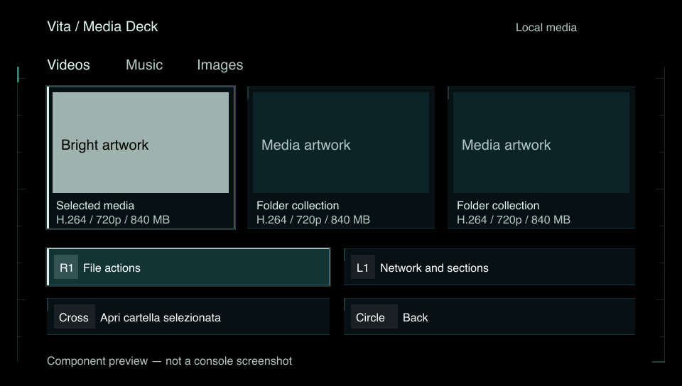

# Cyberpunk UI study

> Dated implementation/research record. Integrated status: [VitaMediaDeck 1.4.1](releases/1.4.1.md); [validation guide](VALIDATION.md). Build IDs, figures and pending checks below describe the recorded snapshot. External research links were not revalidated for this patch release.

Originating branch: `feature/cyberpunk-ui-study`. This shared-component pass is included with the accumulated 1.3.0 work in the local master integration. This document records the design study, not publication or hardware acceptance.

## Direction: quiet cybernetic terminal

An original interface inspired by the restrained cybernetic instrumentation in Ghost in the Shell, without copying franchise artwork, logos, or screen layouts. The media remains the subject; the interface supplies structure and state.

| Token | Color | Role |
| --- | --- | --- |
| Black | `#000000` | OLED canvas and media backdrop |
| Graphite | `#071013` | Opaque cards and drawers |
| Petrol | `#0C2428` | Raised surfaces |
| Jade | `#60DCC3` | Selected/action signal |
| Ice | `#DBF3EC` | Readable foreground and focus edge |
| Amber | `#E7B16B` | Warnings, not ambient decoration |

Keep the existing Inter Medium/SemiBold font assets and native-size 16/20/28 px hierarchy, including the existing system fallback for non-Latin scripts. No new font atlases or textures. Keep left-aligned navigation and file metadata; centered composition remains appropriate for artwork and playback. Preserve three-column local grids and all existing touch/hardware bindings.

```text
Brand / location                         Loading / network / clock
Tabs
Media grid or list                       R1 view/actions drawer
                                         Consistent key | action
Active player / transfer entry remains available through navigation
```

## Review before implementation

The current palette is already cyberpunk-inspired. More moving particles, glowing rings, or corner brackets would duplicate its existing visual devices. This pass instead spends its visual emphasis on selection: opaque surfaces, a persistent leading rail, a clear edge, and restrained mint/cyan. Background instrumentation stays in the outer gutters, away from labels and artwork. No decorative numbers, invented telemetry, blur passes, or perpetual background scan.

## Scope

- Simplify the shared background to static edge instrumentation.
- Make common card fills opaque and distinguish raised/selected surfaces.
- Replace inactive corner brackets with quiet edges; reserve strong framing for focus.
- Left-align action labels after their key cap.
- Keep existing animated focus movement and Reduce motion handling intact.
- Do not change player clocks, decoders, subtitle ordering, eco mode, layout geometry, network transports, or service authentication.

## Verification

Build the optimized Vita VPK and validate its archive/dependencies. Exercise the actual shared drawing code in a host-side primitive renderer to compare decoration counts and inspect a 960x544 component preview. Such a preview is not a Vita screenshot or proof of hardware performance. On console, check dark/bright covers, Italian/English labels, mini-player plus drawers, selected cells, and both motion settings before promoting the design.

Host-side review: `ui_chrome_background()` issues 21 drawing primitives, compared with 254 previously (including 96 circles). Both Reduce motion settings were exercised. This is a roughly 92% reduction for this function only, not a measurement of frame time, overall draw calls, battery life, or GPU utilization. Main/muted text contrast against the selected surface measures 11.50:1 and 7.47:1; faint text was brightened after review to clear 4.5:1 there. These token-level calculations do not certify every overlay or artwork composition in the app.


